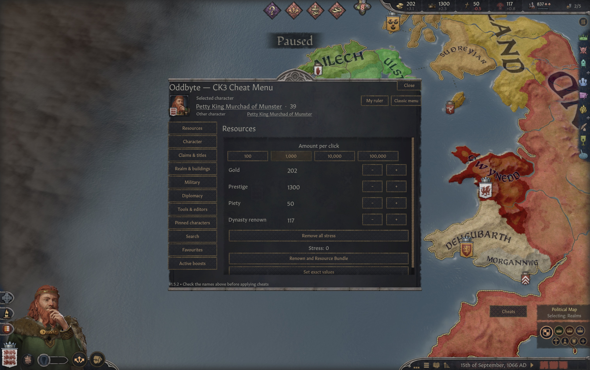

# Oddbyte — CK3 Cheat Menu

A single-player cheat menu and character editor for **Crusader Kings III**. Change your ruler, edit other characters and shape your realm from a movable in-game window.

**[Download the latest release](https://github.com/wademanuk/oddbyte-ck3-cheat-menu/releases/latest)** · [Installation](docs/INSTALLATION.md) · [Feature guide](docs/FEATURES.md) · [Report a bug](https://github.com/wademanuk/oddbyte-ck3-cheat-menu/issues)

**Version 1.5.2 · CK3 1.20.x · English · Single-player**

## What you can do

| Tools | Examples |
| --- | --- |
| Resources and character | Gold, prestige, piety, renown, stress, skills, age, health and fertility |
| Traits and lifestyles | Trait browser, trait experience, lifestyle experience and perk points |
| Diplomacy and family | Hooks, opinions, relationships, marriage, adoption and house changes |
| Realm and titles | Claims, title transfers, vassals, contracts, counties and fast construction |
| Military | Refill existing troops, improve commanders and resolve a selected war |
| Culture and religion | Culture, faith and rite changes; innovations, traditions, doctrines and tenets |
| Court and artifacts | Recruitment, council appointments, character creation and artifact tools |

Pin up to eight characters, save favourite actions, search by word start and remove active boosts. Major changes open a confirmation naming the affected people and objects.

## Start playing

1. [Install the mod](docs/INSTALLATION.md) and enable **Oddbyte — CK3 Cheat Menu** in your launcher playset.
2. Load a single-player game and click **Cheats** near the lower-right map controls. **Decisions → Open Cheat Menu** also opens the window.
3. Check the **Selected character** name before applying a cheat. To edit someone else, right-click their portrait and choose **Cheat Menu: Open Editor**.
4. Open **Tools & editors** for the extended tools. For actions involving two people, choose **Cheat Menu: Set Other Character** on the second person's portrait.

No debug mode or console commands are required. The **Classic menu** remains available inside the window.

## Compatibility and limits

- Built for CK3 **1.20.x** and tested on **1.20.1.2 on macOS**. Other game versions are not verified.
- Relevant DLC features still require their DLC. The catalog does not include extra choices added by other mods.
- Existing saves can load the mod. Make a separate save before changing titles, family links or religious rules: many edits have no undo button.
- Remove unwanted custom boosts before disabling the mod. Added building-slot capacity depends on the mod remaining enabled.
- Multiplayer and combinations with other mods are not verified. No vanilla GUI files are replaced.

See the [feature guide](docs/FEATURES.md) for exact targeting, limits and removal options, and [testing notes](docs/TESTING.md) for verified coverage and remaining checks.

## Source and development

The repository includes the generated mod, its Python generators and regression checks. Players only need the release download; Python is used for development.

[Development guide](docs/DEVELOPMENT.md) · [Changelog](CHANGELOG.md)

Oddbyte makes mods and tools for players. This is an unofficial community mod, not affiliated with Paradox Interactive.
